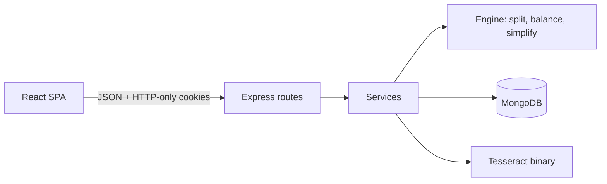
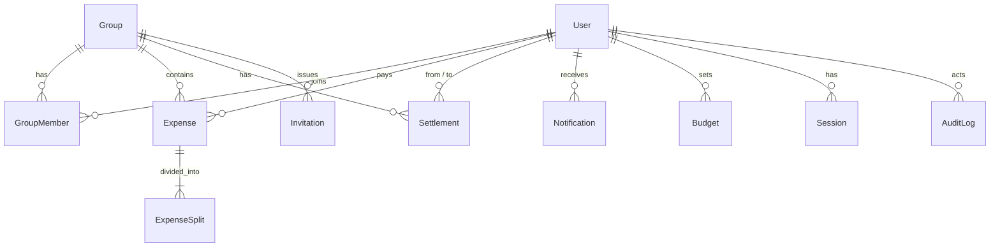

# Architecture

Modular monolith: React SPA → Express API → MongoDB. Layers: Route → (Zod validation, auth) → Service → Mongoose models; the pure `engine` has no I/O.

## ER diagram

## Financial consistency rules
1. Σ ExpenseSplit.owedPaise = Expense.amountPaise (checked by engine and service).
2. Payer and all participants must be active group members.
3. Expense edits replace splits in one transaction and bump `version` (optimistic concurrency).
4. Σ net balances in a group = 0.
5. A settlement cannot exceed the current debt; `idempotencyKey` stops duplicates.
6. Only the receiver confirms/rejects; only the requester cancels.
7. Members with a non-zero balance cannot leave or be removed.

Full endpoint list: Swagger UI at `/docs` when the server runs.
